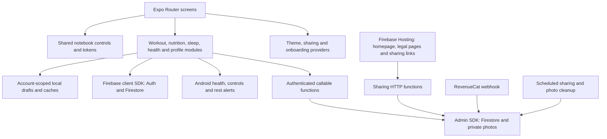

# Lastrep architecture audit

Date: November 6, 2026. Baseline: `main` at `71ef49f`.

## Assessment

Lastrep has areas of tightly coupled code, especially its main screen controllers,
but the evidence does not justify describing the entire application as spaghetti
code or replacing its architecture. Domain modules, shared notebook controls,
explicit contracts and substantial behavioral tests already provide useful
boundaries. The weakest boundary is between screen orchestration and domain state.
Persistence safeguards also vary by feature.

Prioritize data integrity and account isolation, then strengthen automated checks,
then extract responsibilities when modifying the relevant screens. A broad rewrite
would put working drafts, imports and compatibility behavior at unnecessary risk.

This audit created working rules and a PR template. It did not change application
behavior, data, deployed services or permissions. Proposed fixes are in the
[cleanup backlog](architecture-cleanup-backlog.md).

## Scope and limits

Reviewed route/provider composition, domain services and models, persistence,
Firebase rules/functions/hosting, native Android integration boundaries, build
configuration and test/CI coverage. Traced representative flows for authentication,
workout drafts/programs, Today's Plan, health imports, nutrition, sharing, photos,
billing and account deletion. This is a repository-wide architecture review with
targeted deep inspection, not a line-by-line correctness or security certification.

No production logs, billing dashboard, installed older clients, live account
deletion, concurrent-device reproduction, device interaction, Gradle compilation,
dependency vulnerability scan or load test was performed. Statements below
distinguish source-confirmed weaknesses from unmeasured operational impact.

## Architecture map

Important ownership boundaries:

| Area | Current owner / persistence |
| --- | --- |
| Identity | Firebase Auth; several screens/providers subscribe independently |
| Profile and summaries | Root `users/{uid}` document, shared by multiple domains |
| Workout in progress | Workout route state plus account-scoped AsyncStorage draft slots |
| Programs | Firestore programs, runs and occurrences; transactions protect key transitions |
| Completed workouts/routines | Separate per-user Firestore documents |
| Today's Plan | Local deterministic engine; context loaded from account records |
| Nutrition | Per-user meal documents and profile/settings fields |
| Sleep | Session ledger with revision-controlled writes and derived compatibility summaries |
| Body composition | Root-document snapshots and bounded history array |
| Steps | Permission-aware foreground reads, local/account snapshots; display only |
| Sharing | Server-controlled discovery, deliveries, receipts, links and imports |
| Profile photos | Authenticated backend processing and private Storage objects |
| Premium | Server-owned entitlement document fields; RevenueCat/Play integration |

### Current guidance is not an AI request

[`useWorkoutTodayPlan.ts`](../src/workouts/workoutLog/useWorkoutTodayPlan.ts)
calls `loadWorkoutPlanContext` and `buildDeterministicTodayPlan`. The current
review action does not call OpenAI. Progression is incorporated in this review;
there is no separate per-exercise Progress action to bring back.

The repository also retains a legacy callable AI decision service. Its existence
does not establish current usage or charges; see A8 below.

## Structural evidence

A TypeScript-AST scan covered 303 production modules under `app`, `src`,
`components`, `hooks`, `constants` and `functions/src`, excluding tests,
declarations and generated sharing contracts/templates. Counts are approximate
source indicators, not maintainability scores or enforced limits.

| Module | Lines | `useState` calls | Effect calls |
| --- | ---: | ---: | ---: |
| Workout log route | 4,222 | 108 | 24 |
| Home route | 2,601 | 66 | 11 |
| Profile route | 1,723 | 62 | 15 |
| Backend entry point | 1,496 | 0 | 0 |
| Sharing dialogs | 1,060 | 23 | 5 |
| Shared exercise cards | 1,011 | 0 | 0 |
| Sharing plan editor | 900 | 28 | 1 |

The scan found no cycles among resolved emitted static runtime imports/exports
after TypeScript erased type-only dependencies. Three declaration-level cycles
disappeared after that erasure. This does not cover dynamic imports, native
dependencies or all platform-specific resolution; it is not proof of universal
acyclicity.

High reuse of notebook controls and tokens is a strength. High line counts alone
are not findings; the ownership and failure consequences below are the reasons
to act.

## Findings

Priority definitions: **P1** merits an early focused fix because data integrity or
account deletion is affected. **P2** belongs in planned maintenance, with urgency
depending on exposure and growth. No P0 emergency was established.

### A1 — P1: Body-history additions can overwrite concurrent changes

**Evidence:** [`bodyComposition.ts`](../src/bodyComposition/bodyComposition.ts),
`saveManualBodyCompositionEntry` at line 271 and provider import writers around
lines 536 and 633, read an existing profile and subsequently replace its history
array with `setDoc(..., { merge: true })`. Edit/delete paths around lines 320–332
already use transactions.

**Trigger/consequence:** two devices, or overlapping manual/import operations,
read history H. One writes H+A; the other writes H+B. The latter replaces the
array and A disappears. A stale addition can also undo a concurrent edit/delete.
Merging the enclosing document does not merge array contents. This is a
source-confirmed race, not observed loss in a user's account.

**Direction:** perform provider reads outside transactions, then atomically merge
the resulting candidate against the latest saved history and fingerprint. Keep
normalization, deduplication and source semantics. A collection migration is not
required to close this race.

### A2 — P1: Billing writes can recreate data after account deletion

**Evidence:** [`functions/src/index.ts`](../functions/src/index.ts),
`deleteMyAccount` at line 1270 recursively deletes the user document before
deleting Auth. `revenuecatWebhook` at line 1298 reads a user document and writes
entitlement fields using merge at line 1416 without requiring the account to
exist or checking its deletion marker.

**Trigger/consequence:** a valid delayed subscription event after deletion can
create `users/{oldUid}` again. This recreates billing metadata, not deleted health
or workout history. A webhook during deletion also lacks a consistent deletion
gate. Existing client-write rules protect the marker itself but do not make it
a general account-deletion barrier.

**Direction:** define account lifecycle eligibility for backend writes, reject
late billing updates for deleted/deleting owners, and test retry/concurrency.
Checking Auth alone is insufficient during the interval before Auth deletion;
checking a missing user document alone needs an explicit policy for legitimate
initial purchase events. Preserve webhook idempotency and permanent grants.

### A3 — P2: Entitlement hook retains the previous account's result

**Evidence:** [`useEntitlement.ts`](../src/hooks/useEntitlement.ts), lines 19–81,
keeps unkeyed `state` and `isSubscribed` across UID changes. Subscription cleanup
occurs, but state is not reset or returned with an owner UID. Home, Settings,
Profile and Paywall use this hook.

**Trigger/consequence:** switching A to B while a consumer stays mounted can
temporarily expose A's subscription presentation for B until B's first snapshot.
Returning loading while signed out does not clear the retained values. Source
inspection establishes the stale-state window; its duration was not measured.
This is not evidence that server entitlement protection can be bypassed.

**Direction:** key results by UID and reject stale callbacks; return loading for
the new UID until its own result arrives. Test active A → inactive B, sign-out,
errors and delayed snapshots.

### A4 — P2: Green CI omits important boundary checks

**Evidence:** [Quality Checks](../.github/workflows/web-export-check.yml) runs
lint, Functions compilation, static Android verification, Vitest and web export.
It does not run the root TypeScript check or start Firebase emulators.
[`vitest.config.mts`](../vitest.config.mts) includes JS/TS tests, not TSX tests.
Rules and program/sharing/sleep integration suites conditionally skip without
emulator environment variables.

**Consequence:** CI can pass without exercising authorization rules or
transactional import/program/sleep behavior. Many wiring tests inspect source
strings; these help enforce invariants but do not establish interaction behavior.
Static Android verification is valuable but does not compile Kotlin or run alerts.

**Direction:** add root type checking and a disposable `demo-` Firebase emulator
job that fails if its intended suites skip. Add selected component tests when
extracting controllers. Keep a proportionate native build/device release gate;
do not require a phone for every copy change.

### A5 — P2: Screen controllers own too many independent transitions

**Evidence:** [`workout/log.tsx`](../app/%28tabs%29/workout/log.tsx) combines exercise
editing, draft hydration/persistence, program transitions, routines, timers,
sharing entry points and review orchestration. Home and Profile also combine
many editors, data subscriptions and modal state. The counts above indicate the
scale; the number of independent responsibilities is the actual concern.

[`WorkoutExerciseCards.tsx`](../src/workouts/workoutLog/WorkoutExerciseCards.tsx)
uses a large controller-shaped prop contract.
[`SharingPlanEditor.tsx`](../src/sharing/SharingPlanEditor.tsx) reuses the visual
component, but supplies no-op callbacks for workout-only behavior, including
history, completion and copying Last sets.

**Consequence:** a change to one flow requires understanding unrelated state and
can break edit/cancel/persistence behavior elsewhere. Shared visual reuse is
working; duplicating the editor would sacrifice that benefit.

**Direction:** extract one stateful responsibility at a time behind a focused
controller interface. Separate shared exercise presentation/editing capabilities
from session-only commands. Preserve the existing model and UI during extraction;
do not replace 108 state variables with an equally tangled global store.

### A6 — P2: Sleep mutation cost grows with lifetime history

**Evidence:** [`sleepJournal.ts`](../src/sleep/sleepJournal.ts), lines 31–75,
loads the entire ledger for reads and fetches it from the server for each
mutation. Revision conflicts can repeat the read up to four times. The 450-write
guard bounds mutation size, not records read. Excluded imported sessions remain
for intentional deletion semantics.

**Consequence:** a small edit gets more expensive and slower as history grows.
No production latency or cost threshold was measured. Existing revision checks
are useful protection and should not be removed as an optimization.

**Direction:** measure synthetic long histories; then scope mutation reads to
affected dates/source windows and preserve overlap, exclusions and compatibility
summaries. Paginate historical display independently from current summaries.

### A7 — P2: Root user document couples unrelated feature updates

**Evidence:** body history, sleep compatibility summaries, steps, recovery,
profile/preferences and entitlement share `users/{uid}`. Several screens/providers
subscribe independently. [`loadWorkoutPlanContext.ts`](../src/services/decision/loadWorkoutPlanContext.ts)
also loads domain profiles whose implementations read this root document.

**Consequence:** unrelated writes can trigger broad snapshot processing and
increase contention. Body history is bounded to 400 entries, which is also a
product retention constraint, not unlimited history. Duplicate subscriptions do
not by themselves prove separate billed reads; SDK multiplexing/cache behavior
and actual request counts were not measured.

**Direction:** first reuse one account snapshot inside a context load and select
only relevant fields. Measure before moving domains into separate documents.
Clarify the 400-entry retention expectation before any history migration.

### A8 — P2: Legacy AI service lifecycle is ambiguous

**Evidence:** the current local review flow is described above. Meanwhile
[`getDecision.ts`](../src/services/decision/getDecision.ts) retains a cloud caller
with no production caller found in the inspected source, and the backend exports
`getDailyDecision`. Its OpenAI switch defaults on outside the emulator unless
configured otherwise (`index.ts`, around lines 146–153 and 730).

**Consequence:** dead client code and potentially callable backend behavior
increase maintenance and cost-policy ambiguity. This audit does not establish
that the live endpoint is enabled, receiving traffic or incurring charges.
Older installed versions may still depend on it.

**Direction:** inventory live deployment/configuration and recent invocations,
decide an older-client compatibility policy, then explicitly retain, disable or
retire the service. Do not silently remove it based only on current callers.

## Safeguards worth preserving

- Sharing uses server-controlled writes, authenticated operations, bounded search,
  request identity/deduplication and independent imported copies. Link previews
  validate tokens and apply restrictive cache/referrer/content policies.
- Program runs and occurrence identities are independent of display names;
  transactions and stable IDs protect important lifecycle/import operations.
- Draft slots preserve separate/program contexts and use account-scoped storage.
  Sharing, steps and sleep include several explicit UID/generation guards.
- Sleep revision checks protect derived summaries; imported exclusions are not
  treated as missing data or silently recreated by normal sync.
- Profile photos are processed server-side into private storage. Clients cannot
  write entitlement fields or server-owned sharing records through Firestore rules.
- Native rest alerts have owner identity and persistent alarm records. Shared
  native templates/configuration have a dedicated static consistency verifier.
- Production health connection status is distinguished from saved account data.

These are code-level safeguards, not a claim that every race or deployed
configuration has been verified.

## Verification performed for this audit

| Check | Result |
| --- | --- |
| `npx.cmd tsc --noEmit --pretty false` | Passed |
| `npm.cmd run lint` | Passed |
| `npm.cmd --prefix functions run build` | Passed |
| `npm.cmd run verify:android-native` | Passed; source/configuration checks only |
| `npm.cmd test` | 125 files passed, 7 skipped; 901 tests passed, 51 skipped |
| Static import/state inventory | Completed with the scope/limitations above |

No full web export, Firebase emulator suite, native build, phone review or live
deployment was run for this documentation task. Existing passing checks do not
disprove the identified interleavings.

## Recommended sequence

1. Review this report and approve focused cleanup scope.
2. Fix A1 with concurrent-write regression coverage.
3. Address account lifecycle A2 and entitlement ownership A3 in separate changes.
4. Make emulator/type checks repeatable in CI (A4), ideally alongside the first
   fixes so their regressions stay covered.
5. Measure A6/A7, resolve the legacy-service policy A8, and extract A5 boundaries
   incrementally during relevant work.

Use the new root [working rules](../AGENTS.md) and
[PR template](../.github/pull_request_template.md) for proportionate review.
Repeat a broad audit after a substantial new cross-domain integration or when
recurring failures indicate the boundaries have changed; ordinary PRs should
review their affected boundaries continuously.
